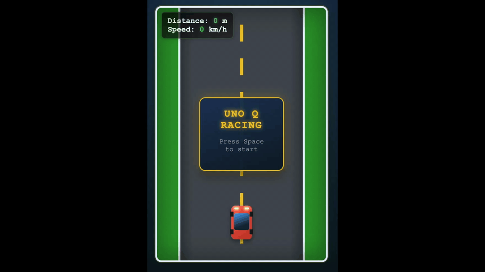

# 🕹️ UNO Q Racing Joypad

An endless top-down racing game for the browser, controlled with physical Arduino hardware. Built with [Arduino App Lab](https://www.arduino.cc/).

## Overview

Drive your car down an endless road, dodge incoming obstacles, and go as far as possible. The game runs in the browser; steering, start/restart, and feedback (vibration and LEDs) are handled by the Arduino board in real time.

## Hardware

- Arduino UNO Q
- Modulino Joystick — steering (joystick mode) and start/restart button
- Modulino Movement (IMU) — steering (tilt mode)
- Modulino Pixels — 8-LED speed bar
- Modulino Vibro — crash feedback

## How to Play

1. Press the joystick button to start.
2. Steer left/right to avoid obstacles and keep driving.
3. Switch steering mode anytime with the **Steer** button on screen (Joystick ↔ IMU tilt).
4. Crashing into an obstacle ends the run, triggers the vibration motor, and flashes the LED strip red.
5. Press the joystick button again to restart.

Speed increases the longer you survive, and the LED strip doubles as a live speedometer (green → orange → red).

## Project Structure

- `python/main.py` — bridges joystick/IMU input and game events between the browser and the board
- `sketch/sketch.ino` — reads the Modulino Joystick/IMU, drives the LED bar and vibration motor
- `assets/` — browser game (HTML, CSS, JS)
